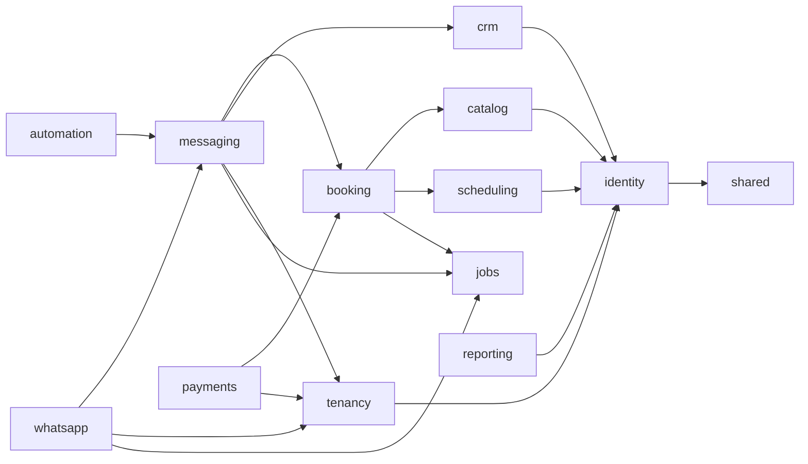
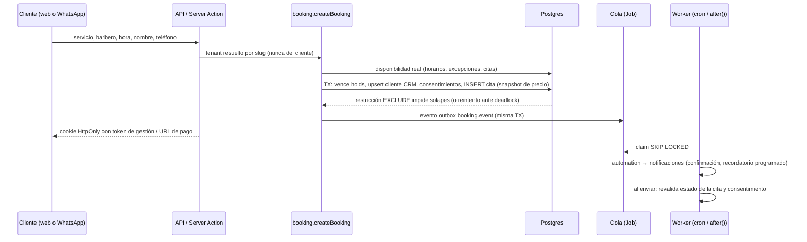

# Arquitectura

## Decisión: monolito modular en Next.js (no NestJS + worker + Redis)

El cliente desplegará en **Vercel + Supabase** y pidió "no complicarse". Se adaptó el diseño original:

| Original | Implementado | Motivo |
|---|---|---|
| NestJS (API) + Next.js (web) | **Una app Next.js** con route handlers y Server Actions | Un solo despliegue en Vercel, un solo proceso de build |
| Worker BullMQ + Redis | **Cola en Postgres** (`Job`, `FOR UPDATE SKIP LOCKED`) + **Vercel Cron** / `pg_cron` | Vercel no mantiene procesos vivos; evitar otra infraestructura |
| Monorepo pnpm (apps/, packages/) | Un paquete con módulos en `src/modules` | Menos configuración; los límites se imponen con ESLint |
| class-validator | **Zod** en el servidor | Un solo sistema de validación compartido |

Si en el futuro hace falta, cualquier módulo puede extraerse: ya expone su API en `index.ts` y no comparte estado.

## Capas y reglas de dependencia

```
src/app  ──►  src/server (composición)  ──►  src/modules/*  ──►  src/shared
   └──────────────────────────────────────────►  (API pública de módulos)
```

- `src/app` (UI, Server Actions, API): **no importa** `@/shared/db` ni el cliente Prisma, y solo usa `@/modules/<m>` (nunca archivos internos). Lo impone `eslint.config.mjs` (`no-restricted-imports`).
- `src/server`: raíz de composición. Es el único lugar donde se conectan módulos que no deben depender entre sí (p. ej. reserva + checkout, bot + motor de reservas, registro de handlers de la cola).
- `src/modules/*`: lógica de dominio. Dependencias permitidas (sin ciclos):



`whatsapp` no depende de `booking`: el bot recibe **puertos** (`BotPorts`) que `src/server/bot-ports.ts` implementa con los mismos servicios que usa la web.

## Flujo de una reserva



- **Un único motor de reservas** (`modules/booking`) para web, bot y panel.
- **Outbox**: los efectos (mensajes) se encolan en la misma transacción que el cambio: nunca se envía algo de una transacción revertida, y nunca se pierde un evento.
- **Idempotencia**: `Appointment(tenantId, idempotencyKey)`, `Notification(tenantId, dedupeKey)`, `Job.dedupeKey`, `PaymentWebhookEvent(provider, eventKey)`, `ConversationMessage.providerMessageId`.

## Cola de trabajos

| Tipo | Lo produce | Lo procesa |
|---|---|---|
| `booking.event` | booking (outbox) | automation.onBookingEvent |
| `notification.send` | messaging.enqueueNotification | messaging.sendNotification |
| `whatsapp.inbound` | webhook de WhatsApp | whatsapp.processInboundMessage (bot) |

- `/api/cron/jobs` (cada minuto): vence holds de pago y procesa la cola. Además, tras crear una reserva o recibir un webhook se ejecuta `after(drainSoon)` para enviar al instante.
- `/api/cron/daily`: clientes inactivos, conciliación de pagos pendientes, limpieza de sesiones/rate limits/jobs.
- Reintentos con backoff exponencial; `NonRetryableError` → `DEAD`. Un envío que quedó en `SENDING` (proceso caído tras llamar al proveedor) **no** se reintenta solo, para no duplicar mensajes: queda visible en el panel.

## Zonas horarias

- En BD: instantes (`timestamptz`). Horarios semanales: minutos locales de la sucursal.
- `shared/time.ts` convierte "fecha local + minutos" a instante con `Intl`, sin dependencias, y maneja los cambios de horario de verano (horas inexistentes avanzan; horas repetidas toman la primera). Probado con el cambio de Chile.
- La disponibilidad (`scheduling/availability.ts`) es una **función pura** testeada aparte del cargador de BD.

## IA opcional en el bot

`IntentInterpreter` (en `modules/whatsapp/bot.ts`) define el único punto donde un modelo podría intervenir: **elegir una de las opciones ya ofrecidas** a partir de texto libre. No consulta la BD, no inventa horarios ni precios y no ejecuta acciones; todo pasa por los mismos servicios validados. No está activado.
