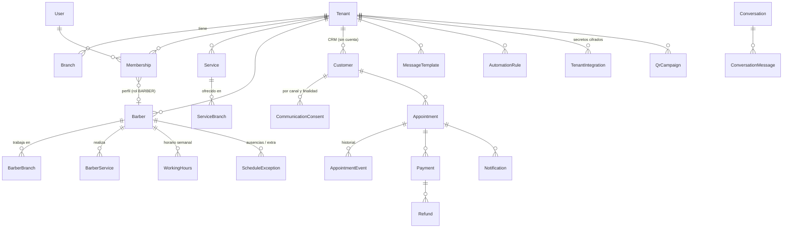
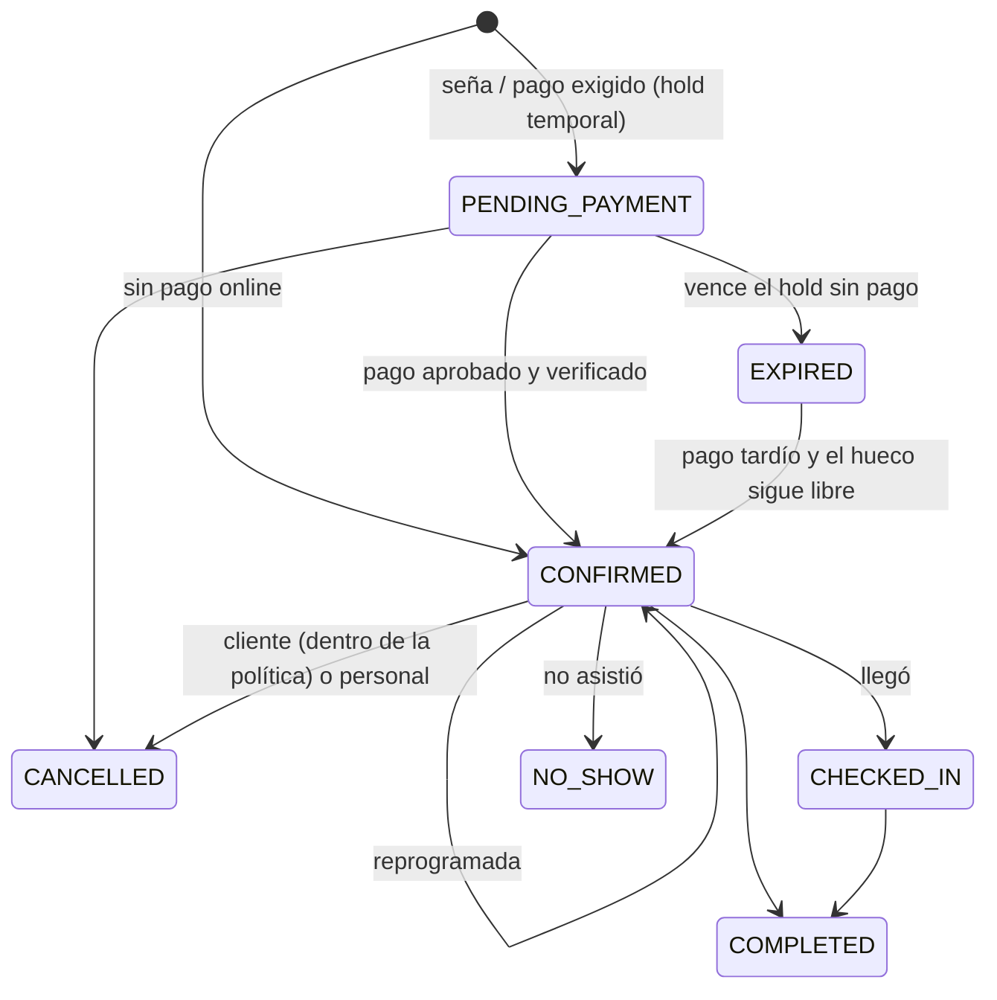
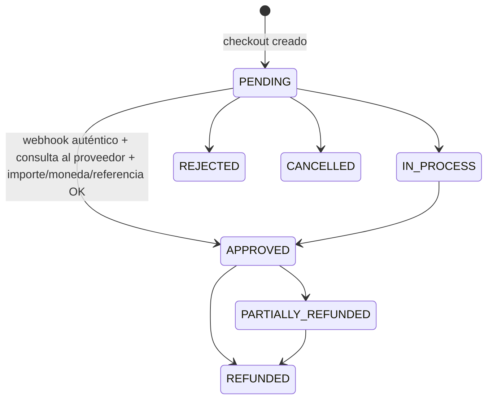

# Modelo de datos

Fuente de verdad: [`prisma/schema.prisma`](../prisma/schema.prisma) y las migraciones en `prisma/migrations/`.

## Principios

- **Multi-tenant con Postgres compartido**: toda entidad de una barbería lleva `tenantId`.
- **FK compuestas `(tenantId, id)`** en las relaciones obligatorias (cita→barbero/servicio/sucursal/cliente, pago→cita…): la base de datos **rechaza** mezclar datos de dos barberías aunque el código fallara.
- **Restricción de exclusión** `Appointment_no_overlap` (`btree_gist`): un barbero no puede tener dos citas activas que se crucen en `[startsAt, blockedUntil)`. `blockedUntil = fin + tiempo entre citas`.
- **Snapshot** en cada cita: nombre del servicio, precio, moneda, duración y buffer. Cambiar el catálogo no altera el historial.
- **Importes enteros** en unidad menor (CLP = pesos). `CHECK` de importes no negativos, rangos de horarios, comisiones 0–100 %.
- **RLS activado sin políticas** en todas las tablas: la API REST de Supabase (roles `anon`/`authenticated`) no ve nada. La app se conecta con el rol dueño de las tablas.

## Relaciones principales

Tablas de soporte: `Session`, `PasswordResetToken`, `Invitation`, `RateLimit`, `Job` (cola/outbox), `PaymentWebhookEvent` (idempotencia), `CampaignVisit` (visitas agregadas, sin datos personales), `AuditLog`, `Subscription` (plan SaaS, separado de los pagos de servicios).

## Estados de una reserva

Ocupan agenda: `PENDING_PAYMENT` (mientras el hold no vence), `CONFIRMED`, `CHECKED_IN`, `COMPLETED`.

## Estados de un pago

- Un estado más antiguo (`providerUpdatedAt`) nunca sobrescribe uno más nuevo.
- Pago aprobado de una reserva cancelada → queda **APPROVED** y marcado "requiere reembolso" (auditoría `payment.requires_refund`).

## Gestión de reservas sin login (token)

`<id de la cita>.<versión>.<HMAC-SHA256>` con una subclave derivada de `SESSION_SECRET`:
- 256 bits de MAC, ligado a una sola cita, expira 24 h después de la cita (`manageTokenExpiresAt`), revocable subiendo `manageTokenVersion`.
- **No se guarda** en la BD (ni su hash): se puede regenerar para recordatorios sin almacenar secretos en claro. Si se filtrara `SESSION_SECRET`, se podrían forjar → rotarlo invalida todos los enlaces (ver seguridad).
- Al abrir el enlace se cambia por una cookie HttpOnly de 30 min y se redirige a una URL sin token.
